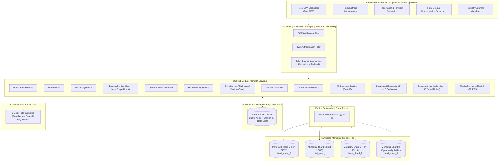
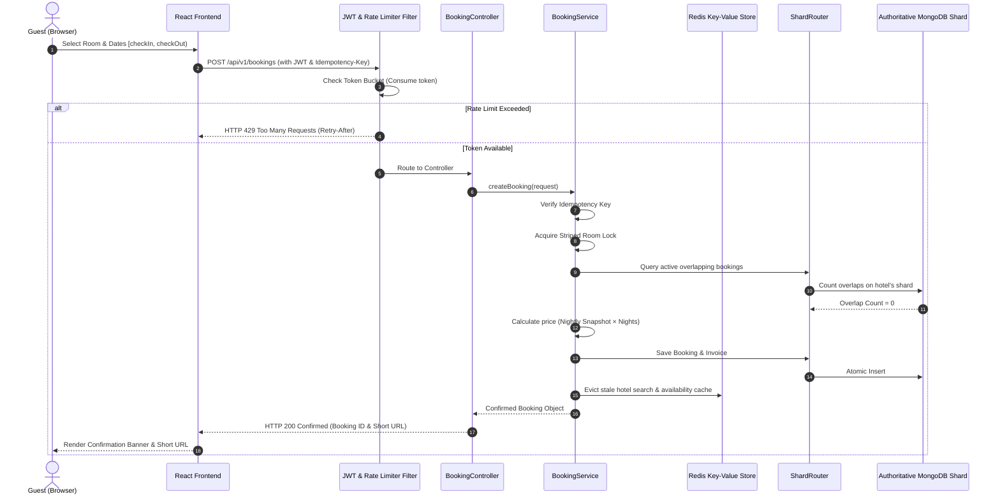
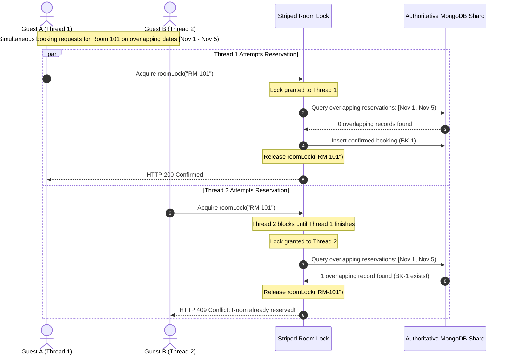
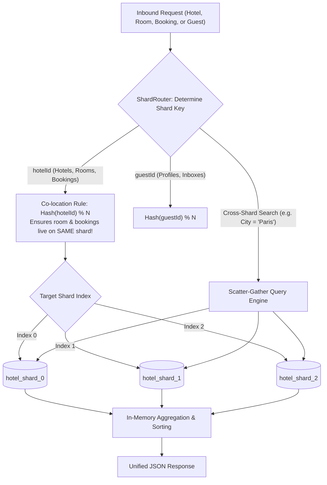
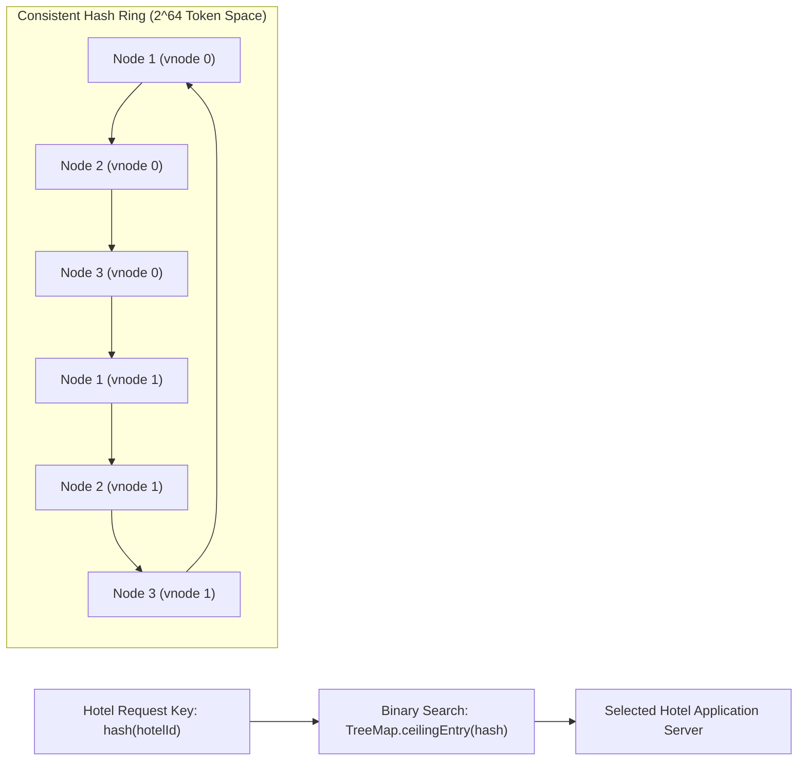
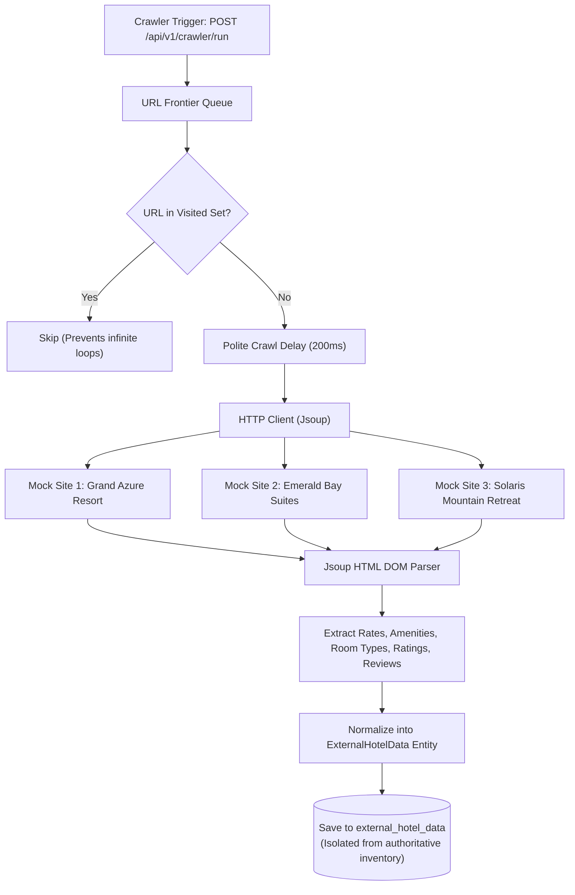

# Scalable Hotel Management System - Architectural Diagrams

## 1. Overall System Architecture



---

## 2. Request Flow: From React Frontend Through Backend Services



---

## 3. Concurrent Booking & Double-Booking Prevention Flow



---

## 4. Shard-Routing Architecture



---

## 5. Consistent Hashing Ring & Virtual Nodes



---

## 6. Redis Cache-Aside Flow with Write-Through Invalidation

```mermaid
flowchart TD
    Req["Hotel Detail Request: GET /api/v1/hotels/HTL-101"] --> CacheCheck{"Cache Hit in Redis?\n(key: 'hotel:HTL-101')"}
    CacheCheck -->|Yes (Hit)| ReturnCached["Return Cached JSON (< 1ms)"]
    CacheCheck -->|No (Miss)| QueryShard["Fetch from Authoritative Mongo Shard (12ms)"]
    QueryShard --> StoreCache["Store in Redis (TTL: 3600s)"]
    StoreCache --> ReturnFresh["Return Fresh JSON"]

    BookingMade["Event: Room Booked or Status Changed"] --> Invalidate["Evict 'hotel:HTL-101' & 'search:*' from Redis"]
    Invalidate --> ConsistentState["Guarantees Next Query Reads Fresh State"]
```

---

## 7. Web Crawler Architecture


